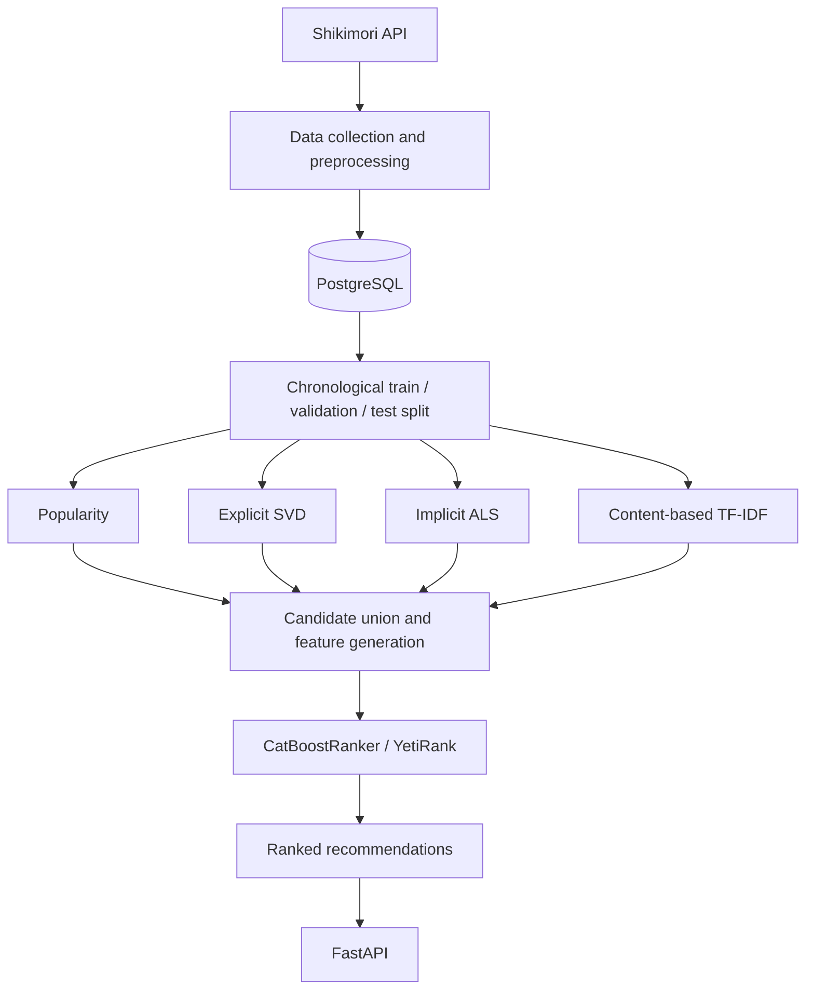

# Shiki RecSys — Hybrid Anime Recommendation System

A personal **machine learning / recommender systems engineering project** that generates personalized anime recommendations for [Shikimori](https://shikimori.one/) users.

The system implements a two-stage recommendation pipeline: **candidate retrieval** from four complementary models, followed by **learning-to-rank with CatBoost**. It also includes offline evaluation, a PostgreSQL-backed data layer, and a FastAPI service for recommendations and user history synchronization.

> **Project status:** under active development. The training and serving pipelines are implemented in code; a hosted demo, populated database, and trained model artifacts are **not** included in this repository.

## Recommendation architecture



The diagram summarizes the offline model pipeline and serving flow. During inference, trained model artifacts are loaded from disk; models are **not** retrained on each API request.

### Stage 1 — Candidate generation

Four retrievers provide complementary recommendation signals:

| Retriever | Approach | Main signal |
| --- | --- | --- |
| **Popularity** | Non-personalized baseline | Item popularity derived from interactions |
| **Explicit SVD** | Collaborative filtering ([Surprise](https://surpriselib.com/)) | Explicit user ratings |
| **Implicit ALS** | Matrix factorization ([implicit](https://github.com/benfred/implicit)) | Weighted implicit feedback from user actions and ratings |
| **Content TF-IDF** | Content-based retrieval | Anime metadata and user preference profiles |

The ALS preprocessing distinguishes different kinds of feedback, including positive and negative signals. Items already known to the user are excluded from the recommendation candidates.

### Stage 2 — Learning to rank

Candidates from the retrievers are merged and deduplicated. The ranking model receives features such as:

- Scores produced by each retriever
- Candidate position in each retrieval list
- Source-presence indicators
- Reciprocal ranks and rank aggregation features
- Number of retrievers that selected the item

A **CatBoostRanker** with the **YetiRank** loss ranks the candidate set. Its training targets are derived from later positive user interactions.

### Cold-start handling

Inference selects a strategy based on user history and model support:

- **Warm users:** four retrievers + CatBoost ranking
- **New or sparsely represented users with useful preferences:** content-based and popularity retrieval
- **Users with empty histories or no positive preference signal:** popularity fallback
- **Unsynchronized / unavailable users:** an explicit state instead of fabricated recommendations

## Training and evaluation

The offline workflow:

1. Loads interaction histories and anime metadata from PostgreSQL.
2. Prepares features and performs a **per-user chronological split**.
3. Fits retrievers on the training portion.
4. Trains the CatBoost ranker on later validation interactions.
5. Evaluates ranked recommendations against held-out test interactions.
6. Refits models for serving and writes a versioned model bundle.

The evaluation protocol computes **Recall@K** and **NDCG@K** for supported warm users. The checked-in configuration uses **K = 20**, with 10% validation and 10% test fractions for eligible user histories.

Evaluation results are written to `evaluation.json` for each generated model version. **No metric values are quoted here because the corresponding dataset and evaluation artifacts are not committed.**

Training parameters are defined in [`configs/training.yaml`](configs/training.yaml).

## Serving and data synchronization

The [FastAPI application](src/shiki_recsys/api/main.py) exposes:

| Method | Endpoint | Purpose |
| --- | --- | --- |
| `GET` | `/health` | Basic health check |
| `POST` | `/users` | Register a Shikimori user |
| `POST` | `/users/{user_id}/sync` | Queue a user history synchronization job |
| `GET` | `/users/{user_id}/sync` | Check the most recent synchronization job |
| `GET` | `/users/{user_id}/recommendations` | Return ranked anime recommendations and user state |

A separate synchronization worker processes queued jobs and fetches user data through the Shikimori API. The service uses SQLAlchemy, PostgreSQL and Alembic migrations.

## Tech stack

- **Language:** Python 3.12+
- **ML:** NumPy, pandas, SciPy, scikit-learn, Surprise, implicit, CatBoost
- **Backend:** FastAPI, Pydantic, SQLAlchemy, PostgreSQL, Alembic
- **Engineering:** pytest, Ruff, GitHub Actions CI, versioned model artifacts (joblib)
- **External data source:** Shikimori GraphQL API

## Local setup

> This is a source-code repository, **not a one-command reproducible demo**. A working PostgreSQL instance, collected interaction data, and locally trained model artifacts are required for end-to-end recommendations.

### 1. Install dependencies

```bash
git clone https://github.com/ritaro-dev/Shiki-RecSys.git
cd Shiki-RecSys
python -m venv .venv
# Activate .venv for your shell / operating system
python -m pip install -e .
```

### 2. Configure PostgreSQL

Create a PostgreSQL database and role with suitable permissions, then add a local `.env` file:

```dotenv
DB_HOST=localhost
DB_PORT=5432
DB_DATABASE=shiki_db
DB_USER=shiki_app
DB_PASSWORD=replace_with_your_local_password
RECOMMENDATION_MIN_POSITIVE_ITEMS=5
```

These are **example local values**, not credentials. `.env` is ignored by Git and must not be committed.

Create the schema with:

```bash
alembic upgrade head
```

### 3. Prepare training data and train

The project includes scripts for collecting the anime catalog and user histories from Shikimori. In particular, [`scripts/collect_animes.py`](scripts/collect_animes.py) handles catalog collection, while [`scripts/collect_user_histories.py`](scripts/collect_user_histories.py) works with a set of seed users.

**Note:** a ready-to-use seed-user dataset and populated database are not included. Some data-collection steps require locally prepared seed-user data and should not be assumed to work on a completely empty checkout.

Once the PostgreSQL tables contain the required interaction histories and anime metadata:

```bash
python scripts/train_models.py --config configs/training.yaml
```

The training script generates a version under `artifacts/versions/<version>/`, including the model bundle, metadata, training configuration, and evaluation results. It **does not promote the new model automatically**.

After reviewing the evaluation results, choose the version to serve:

```bash
python -c "from pathlib import Path; from shiki_recsys.training.model_promotion import promote_model_version; promote_model_version(artifacts_dir=Path('artifacts'), artifact_version='REPLACE_WITH_VERSION')"
```

This updates the local `artifacts/current` pointer.

### 4. Run the API and sync worker

After preparing the database **and** selecting a trained model version:

```bash
uvicorn shiki_recsys.api.main:app --reload
```

Open [`http://127.0.0.1:8000/docs`](http://127.0.0.1:8000/docs) for the interactive API documentation.

The synchronization worker runs separately:

```bash
python scripts/sync_worker.py
```

Example user registration request:

```bash
curl -X POST http://127.0.0.1:8000/users \
  -H "Content-Type: application/json" \
  -d '{"user_id":12345}'
```

Then request synchronization with `POST /users/12345/sync`; after the job finishes, query `GET /users/12345/recommendations`.

## Tests and code quality

Install development dependencies from the repository's lock-style requirements file, then run:

```bash
python -m pip install -r requirements-dev.txt
python -m pip install -e . --no-deps
python -m pytest -q
python -m ruff check .
python -m ruff format --check .
```

[GitHub Actions](.github/workflows/ci.yml) runs linting, formatting checks, and tests on pushes and pull requests to `main`.

## Repository structure

```text
configs/                Training configuration
scripts/                Data collection, training, synchronization
src/shiki_recsys/
  api/                  HTTP endpoints and schemas
  application/          Use cases and job orchestration
  database/             SQLAlchemy models and repositories
  ingestion/            Shikimori data collection
  preprocessing/        Catalog, interactions, chronological splitting
  features/             Features and interaction signals
  retrievers/           Popularity, SVD, ALS, TF-IDF
  ranking/              Candidate features and CatBoost ranker
  training/             Offline model fitting and artifact management
  evaluation/           Recall@K and NDCG@K
  inference/            Warm/cold user recommendation flows
alembic/                Database schema migrations
artifacts/              Local generated model versions (not committed)
tests/                  Automated tests
.github/workflows/      CI configuration
```

## Current limitations and next steps

- The repository does not publish the training dataset or generated model artifacts.
- Local end-to-end use requires PostgreSQL setup and data collection.
- There is currently no Docker Compose setup or publicly hosted demo.
- Publish a reproducible small-data example and measured evaluation results when available.
- Improve developer onboarding and deployment tooling.

---

**Focus:** recommender systems, collaborative filtering, candidate retrieval, learning-to-rank, offline evaluation, and ML/backend integration.
